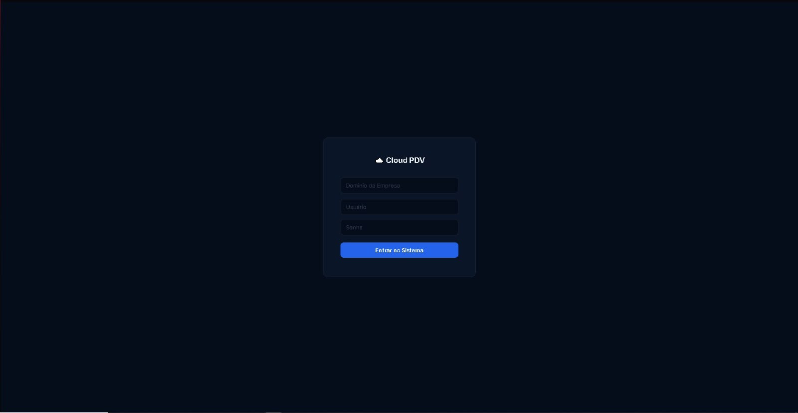
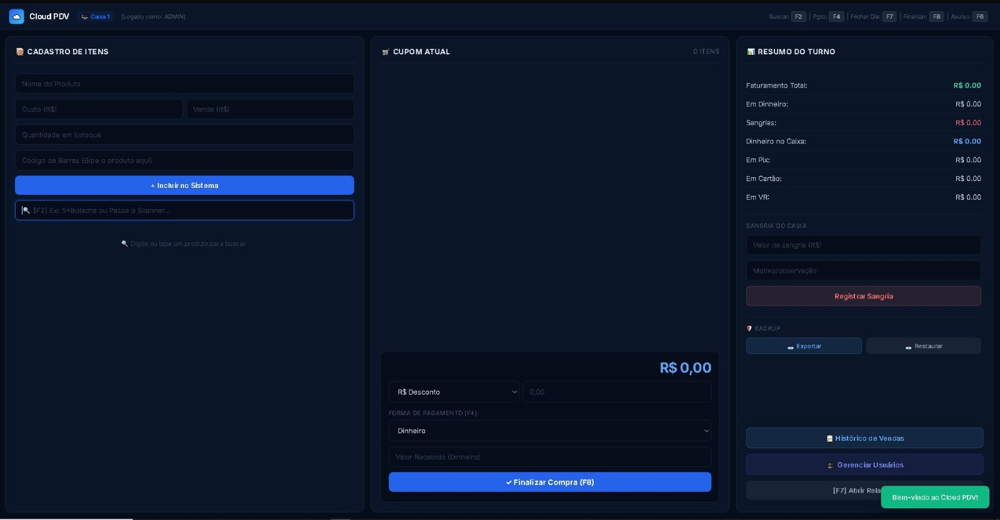
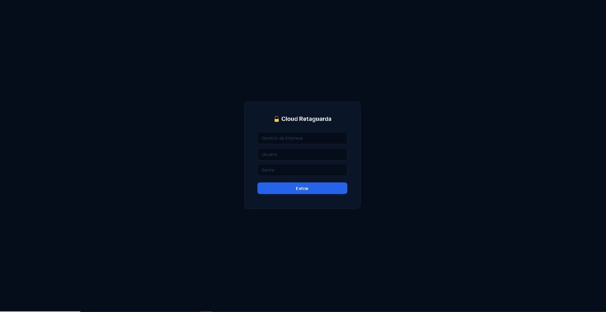
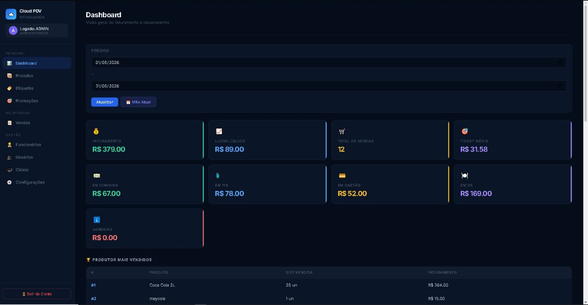

# Cloud PDV

Sistema de ponto de venda (PDV) multiempresa no modelo SaaS, feito para pequenos comércios (mercados, adegas, padarias). Desenvolvi junto com um sócio; o produto chegou a ter mais de 15 clientes pagantes e foi encerrado em 2026. O código está aqui como portfólio.





## O que o sistema faz

- **Caixa (PDV):** venda por busca de produto ou leitor de código de barras (câmera ou leitor USB), formas de pagamento (dinheiro, Pix, cartão, VR e cheque funcionário), troco, cupom não fiscal para impressora térmica 80 mm, sangria e fechamento de caixa.
- **Retaguarda:** dashboard com faturamento, lucro e cancelamentos, histórico de vendas com cancelamento por PIN de supervisor, cadastro de produtos e usuários, promoções por período, impressão de etiquetas (105x30 mm), controle de compras de funcionários com limite.
- **Multiempresa:** cada empresa tem seu domínio de login, usuários e dados. Papéis: admin, gerente e operador.
- **Planos:** Base (1 caixa), Intermediário (até 2 caixas e e-mail de fechamento) e Avançado (caixas ilimitados, gráficos e app).
- **Painel do dono do sistema (`superadmin.html`):** cria empresas, muda plano e vencimento, bloqueia e redefine senha.
- **App PWA** simples para o dono acompanhar as vendas pelo celular (`app/`).

## Tecnologias

- Front-end: HTML, CSS e JavaScript puro (sem framework), Chart.js, Quagga.js, JsBarcode
- Back-end: Node.js, Express, Prisma ORM, PostgreSQL
- Segurança: JWT (12 h), senhas e PINs com bcrypt, bloqueio por tentativas de login
- Infra que foi usada em produção: VPS Ubuntu, Nginx como proxy reverso, PM2, Let's Encrypt

## Como rodar localmente

Pré-requisitos: Node.js 18+ e PostgreSQL.

```bash
cd backend
npm install
cp .env.example .env        # preencha DATABASE_URL, JWT_SECRET e SUPER_ADMIN_SECRET
npx prisma db push          # cria as tabelas
node criarEmpresa.js demo admin suasenha "Mercado Demo"
npm start                   # API em http://localhost:3000
```

Depois abra `frontend/index.html` (por exemplo com a extensão Live Server do VS Code). No login use o domínio `demo`, usuário `admin` e a senha que você definiu. A API é apontada em `frontend/js/api.js`.

## Estrutura

```
backend/    API (server.js), schema do banco (prisma/) e script de criação de empresa
frontend/   PDV (index.html), retaguarda, painel superadmin, js/ e css/
app/        PWA para acompanhar vendas pelo celular
```

## Decisões e o que eu faria diferente

- Todas as rotas filtram por `empresaId` do token, então uma empresa não enxerga nem altera dados de outra.
- Ao cancelar venda, o estoque é devolvido na mesma transação. Cancelamento por operador exige PIN de supervisor.
- **Limitação conhecida:** `POST /vendas` ainda confia no total e nos preços enviados pelo front. O correto seria recalcular tudo no servidor, considerando promoções.
- O envio de e-mail aceita qualquer destinatário informado por um admin autenticado; o ideal seria fixar o e-mail cadastrado da empresa.
- Falta paginação em `/vendas` e testes automatizados.
- Não há emissão de NFC-e. O cupom é não fiscal. A integração seria feita por API de terceiros (Focus NFe, por exemplo).
- Usei JS puro de propósito, para entregar rápido a clientes com computadores simples. Em um projeto novo eu usaria um framework e TypeScript.

## Autor

Gabriel Giaculo da Rocha — [LinkedIn](https://www.linkedin.com/in/gabriel-giaculo-da-rocha-07a926326/) · [GitHub](https://github.com/GabrielGiaculo)
